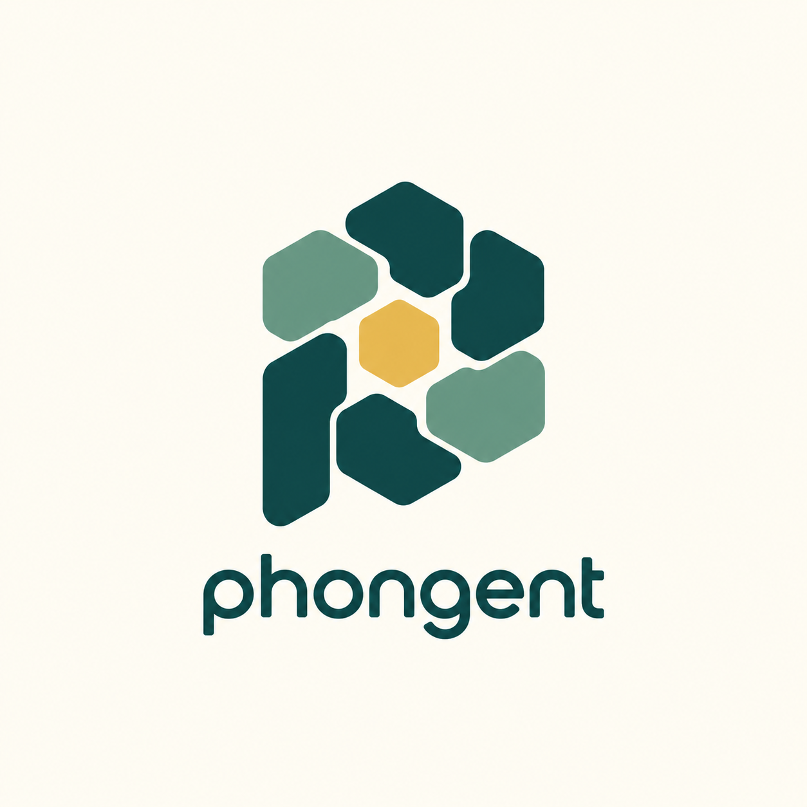
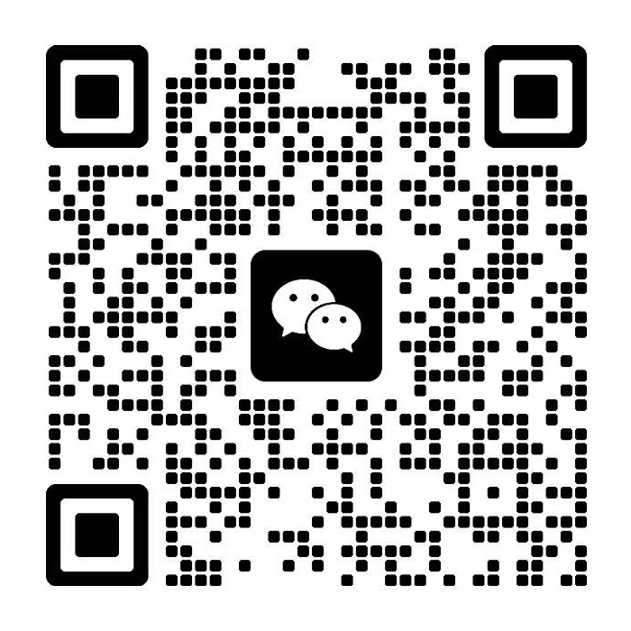

<div align="center">

# phongent



**Let agents across multiple phones work together.**

Assign tasks in natural language and view each device’s progress, notifications, and live screen in one place.

**Both iOS and Android can act as controllers · Android also supports local execution**

[简体中文](README.md) · English

[Demo videos](#demo-videos) · [Getting started](#getting-started) · [Device groups](#devices-and-groups) · [Development](#development-and-builds) · [Contact](#contact)

**[Download Android APK · phongent.apk](https://github.com/mylea1/phongent/releases/latest/download/phongent.apk)**

</div>

## What is phongent?

phongent is a multi-device agent control project. Connect an iPhone or Android phone to multiple Android devices, assign tasks to all devices, a group, or an individual device, and review their results in one place. View notifications received by controlled devices and reply directly from the controller.

Android can manage other devices and operate locally; iOS connects to Android execution devices as a controller.

| Device role | iOS | Android |
| --- | --- | --- |
| Connect to and manage other Android devices | Supported | Supported |
| Assign tasks and view results and messages | Supported | Supported |
| View Android live windows and take over controls | Supported | Supported |
| Execute local app operations | — | Supported |

## Demo videos

### Reply to messages on a controlled device

Open the reply window from a notification and assign the reply to the corresponding Android device’s agent.

[▶ Watch: reply to notifications](docs/media/demos/notification-reply.mp4)

### Control devices to perform tasks

Assign tasks to a device and follow the agent’s phone operations.

[▶ Watch: phone task control](docs/media/demos/phone-task-control.mp4)

## Core features

- **Multi-device task assignment**: long-press a device and describe its task, or let the controller’s dispatch agent assign tasks.
- **Group collaboration**: batch grouping, collapsible group avatars, and group-wide task assignment; supports different tasks for different groups and individual assignments within a group.
- **Content creation and distribution**: the controller model can generate multiple pieces of copy and text-based image cards, then send each device its content and task; image attachments are supported.
- **Live windows**: view Android virtual screens and take over with taps, swipes, and text input. Windows are enabled by default and can be disabled in settings.
- **Centralized messages**: organize notifications by device, application, and source; view details and reply through the target device’s agent.
- **Centralized configuration**: manage memory, skills, scheduled tasks, operation routes, and other settings for individual devices or in batches where supported.
- **Connection and management**: LAN discovery, connection approval, one-tap connection, reconnection, device renaming, and a connected-device grid.

## Assigning tasks

For example:

```text
A, open the Xiaohongshu homepage and take a screenshot.
B, open the browser and check today’s weather.
```

```text
Have each device in the Content group draft a product introduction.
Have the Review group check each device’s task status.
Within the Content group, A should organize existing materials instead;
the other devices should continue drafting.
```

```text
Generate different titles, body text, and text-based image cards
for each device in the Content group. Send them to the corresponding
devices and save them as drafts without publishing.
```

## Getting started

1. **Install this project’s builds.** Install the corresponding Android APK. The iOS app currently requires building and signing with Xcode. Do not substitute an upstream APK for this project’s execution device: it may lack fleet-control interfaces.
2. **Configure Android execution devices.** Configure the model and phone-operation settings in the app, and grant accessibility, notification access, and other permissions required by the features you use. See the [setup guide](docs/setup-guide.md) for underlying phone setup; some names in that guide still follow upstream.
3. **Connect devices.** Put the controller and execution devices on the same LAN and keep the Android service running. Select a device or use one-tap connection on the Devices page. Approve the first connection on Android; authorized devices support reconnection.
4. **Configure the controller model.** Configure the task-dispatch model in the controller’s settings. Complete account login on the relevant device.
5. **Start collaborating.** Select all devices, a group, or an individual device on the agent page, enter a task, and review progress and results by device.

### Devices and groups

- The lower grid shows connected devices only, with device names and groups.
- Tap Group, select devices, choose an existing group or create one, then tap Move N devices.
- Each device belongs to one group. Moving it removes it from the previous group. Ungrouped devices belong to the default group.
- Long-press a device avatar or card to rename it or move it to a group. Renaming is synchronized to the corresponding Android app and requires execution-side support for this interface.
- The agent page’s left sidebar shows collapsible groups of avatars. Groups are stored on the current controller and are not automatically synchronized to other controllers.

### Four main sections

| Section | Purpose |
| --- | --- |
| Devices | Discover, connect, rename, and group devices |
| agent | Assign tasks and view results and live windows |
| Messages | View notifications by device, application, and source |
| Settings | Configure controller, execution, and synchronization options |

## Development and builds

| Directory | Contents |
| --- | --- |
| `app/` | Android app, controller UI, and execution-side services |
| `core/` | Core agent capabilities |
| `ios/` | iOS controller, widgets, and Live Activities |
| `tools/android-emulators/` | Android emulator integration tools |
| `docs/` | Setup guides, protocols, and verification records |

**Android**: JDK 17 and the Android SDK (currently compileSdk 36). The minimum installation version is Android 11; phone-operation capabilities also depend on system version and permissions.

```sh
./gradlew :app:assembleDebug
```

Build output is under `app/build/outputs/apk/debug/`. Ensure the APK is signed with your own development key before installing it.

**iOS**: macOS and an Xcode version supporting the project’s SDK; the minimum deployment target is iOS 17. Open `ios/MikaRemote.xcodeproj`, select the `MikaRemote` scheme, choose your development team in signing settings, and build.

Do not commit model keys, account credentials, or local signing materials.

## Contact

- **X**: [mylea · @myleafy1](https://x.com/myleafy1)
- **WeChat**:

<a href="docs/media/contact/wechat-mylea.jpg"></a>

## Acknowledgments and license

Built on [Mika](https://github.com/wangzan101/mika), extending it with cross-platform controllers and multi-device agent collaboration.

Project code retains the **Apache License 2.0**; see [LICENSE](LICENSE) and [NOTICE](NOTICE). Avatars and other third-party resources retain their respective licenses; see [third-party notices](THIRD_PARTY_NOTICES.md).
